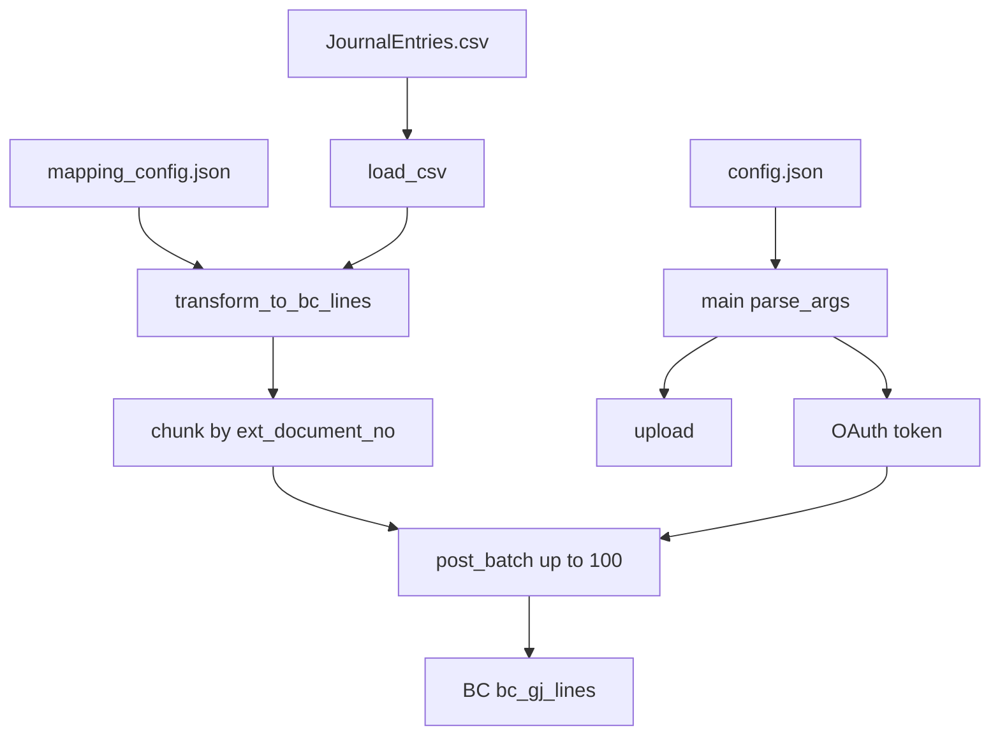

# target-businesscentral

A [Singer](https://www.singer.io/) / [hotglue](https://hotglue.xyz) target that reads `JournalEntries.csv`, maps each row to a Business Central general journal line, and POSTs them to the Chargebee `$batch` API.

## Quick Start

1. Install

    ```bash
    pip install git+https://github.com/hotgluexyz/target-businesscentral.git
    ```

2. Create the config file

   Create a JSON file called `config.json`. Its contents should look like:

   ```json
   {
       "tenant_domain": "<Azure AD tenant domain>",
       "client_id":     "<Azure AD app client ID>",
       "client_secret": "<Azure AD app client secret>",
       "environment":   "<Business Central environment>",
       "company_id":    "<Business Central company GUID>",
       "input_path":    "<directory with CSV files to upload>"
   }
   ```

3. Run the Target

    ```bash
    target-businesscentral --config config.json
    ```

## What it does

1. Reads `{input_path}/JournalEntries.csv`.
2. Loads field mappings from bundled `mapping_config.json` (or `mapping_config_path` if set).
3. Transforms each CSV row into a `bc_gj_lines` payload.
4. Groups lines by Posting ID (`ext_document_no`) so one journal is never split across HTTP calls.
5. POSTs chunks of up to 100 lines to the Business Central `$batch` API.

Rows that share the same Posting ID share the same `ext_document_no` in Business Central and form one logical journal entry.

## Requirements

- Python 3.7.1+

## Configuration

Create a JSON config file (see `sample_config.json`).

### Required keys

| Key | Description | Example |
| --- | --- | --- |
| `tenant_domain` | Azure AD tenant domain | `contoso.onmicrosoft.com` |
| `client_id` | Azure AD app client ID | GUID |
| `client_secret` | Azure AD app client secret | secret |
| `environment` | Business Central environment name | `Sandbox_UK` |
| `company_id` | Business Central company GUID | GUID |
| `input_path` | Directory containing `JournalEntries.csv` | `/path/to/data` |

### Optional keys

| Key | Default | Description |
| --- | --- | --- |
| `timeout_seconds` | `30` | HTTP timeout for auth and `$batch` |
| `mapping_config_path` | bundled `mapping_config.json` | Override the CSV → BC field mapping file |

## Input CSV

The target always reads:

```
{input_path}/JournalEntries.csv
```

Required columns are derived from mappings with `"required": true`. With the bundled config those are:

| Column | Required | Notes |
| --- | --- | --- |
| `Posting Date` | yes | Sent as `posting_date` |
| `Transaction Date` | yes | Sent as `document_date` |
| `Posting ID` | yes | Grouping key; truncated to 35 characters with a warning |
| `G/L Account Number` | yes | Used for both `account_no` and `bal_account_no` |
| `Type` | yes | `Debit` or `Credit` (case-insensitive) |
| `Amount` | yes | Magnitude; sign comes from `Type` |
| `Currency Code` | yes | Sent as `currency_code` |
| `Customer Location` | no | Country dimension; missing or blank becomes `""` |

Missing required columns or an empty required cell fail the run (`TransformError`). The file is read as strings so account numbers stay `"400100"` rather than `"400100.0"`.

## Field mapping (`mapping_config.json`)

Mapping **data** lives in `src/target_businesscentral/mapping_config.json`. Mapping **code** is the handler registry in `mapping.py`. Operators can swap the JSON without a code change via `mapping_config_path`.

### CSV → Business Central

| BC field | Source | CSV column / rule |
| --- | --- | --- |
| `posting_date` | column | `Posting Date` |
| `document_date` | column | `Transaction Date` |
| `ext_document_no` | column | `Posting ID`; strip trailing `.0`; max 35 chars (warn on truncate) |
| `account_no` | column | `G/L Account Number`; strip trailing `.0` |
| `bal_account_no` | column | same `G/L Account Number` |
| `description` | column | `Type` mapped to `"Debit"` or `"Credit"` |
| `amount` | signed_amount | `Amount`; Credit positive, Debit negative; uses `abs` then sign; rounded to 6 decimals |
| `currency_code` | column | `Currency Code` |
| `dim_country` | column | `Customer Location`, or `""` |
| `dim_project` | static | always `""` |

### Handlers

| `source` | Behaviour |
| --- | --- |
| `column` | Read a CSV column. Supports `required`, `default`, `value_map`, `max_length`, `warn_on_truncate`, `normalize` (`account` or `token`). |
| `static` | Constant `value` on every row. |
| `signed_amount` | Numeric amount + `sign_column`. Negate when the sign matches `negate_when` (bundled: `DEBIT`). |

Row errors are collected, logged, then raised as a single `TransformError`. An unknown `source` in the JSON raises `MappingConfigError`.

## API calls

Two HTTP steps.

### 1. Authenticate

```
POST https://login.microsoftonline.com/{tenant_domain}/oauth2/v2.0/token
Content-Type: application/x-www-form-urlencoded

grant_type=client_credentials
client_id=...
client_secret=...
scope=https://api.businesscentral.dynamics.com/.default
```

Stores a Bearer token (refreshed 60 seconds before expiry). A 401 on `$batch` triggers one re-auth and retry.

### 2. Post journal lines

```
POST https://api.businesscentral.dynamics.com/v2.0/{tenant_domain}/{environment}/api/Booksy/Chargebee/v1.0/$batch
Authorization: Bearer <token>
Content-Type: application/json
```

`Booksy/Chargebee` is the Business Central custom API publisher/name, not the Python package name.

Body (up to 100 items):

```json
{
  "requests": [
    {
      "method": "POST",
      "id": "1",
      "url": "companies({company_id})/bc_gj_lines",
      "headers": { "Content-Type": "application/json", "Accept": "application/json" },
      "body": {
        "posting_date": "...",
        "document_date": "...",
        "ext_document_no": "...",
        "account_no": "...",
        "bal_account_no": "...",
        "description": "Credit",
        "amount": 10.5,
        "currency_code": "USD",
        "dim_country": "",
        "dim_project": ""
      }
    }
  ]
}
```

Per-item HTTP `200`, `201`, or `204` is success. A `200` envelope with a missing, empty, or length-mismatched `responses` array is a hard failure.

### Retry policy

GL posting must not double-post.

| Response | Action |
| --- | --- |
| 401 | Re-authenticate once and retry |
| 429 | Retry with exponential backoff |
| ConnectionError | Retry with exponential backoff (request never reached the server) |
| Timeout | Do **not** retry |
| 5xx | Do **not** retry |

Failures are logged then raised (`TransformError`, `EntryPostError`, `AuthenticationError`, …) so Singer's `handle_top_exception` emits CRITICAL and hotglue surfaces the message.

## Code flow



1. `main()` parses `--config` (`singer.utils.parse_args`).
2. `get_client()` authenticates immediately.
3. `upload()` loads mapping, then `load_csv()`.
4. `transform_to_bc_lines()` applies handlers from `mapping_config.json`.
5. `chunk_journal_lines()` packs by `ext_document_no` without splitting a Posting ID, max 100 lines per chunk. A single journal larger than 100 lines raises `TransformError`.
6. Each chunk is `post_batch()`. Remaining chunks still run after an HTTP failure; any failures then raise `EntryPostError`.
7. The HTTP session is closed in `finally`.

### Modules

| Path | Role |
| --- | --- |
| `src/target_businesscentral/__init__.py` | `main`, `load_csv`, `chunk_journal_lines`, `upload` |
| `src/target_businesscentral/mapping.py` | Mapping engine (`column`, `static`, `signed_amount`) |
| `src/target_businesscentral/mapping_config.json` | CSV → BC field mappings |
| `src/target_businesscentral/client.py` | OAuth2 + `$batch` |
| `src/target_businesscentral/const.py` | Config keys, URLs, batch size |
| `src/target_businesscentral/exceptions.py` | `BusinessCentralError` hierarchy |
